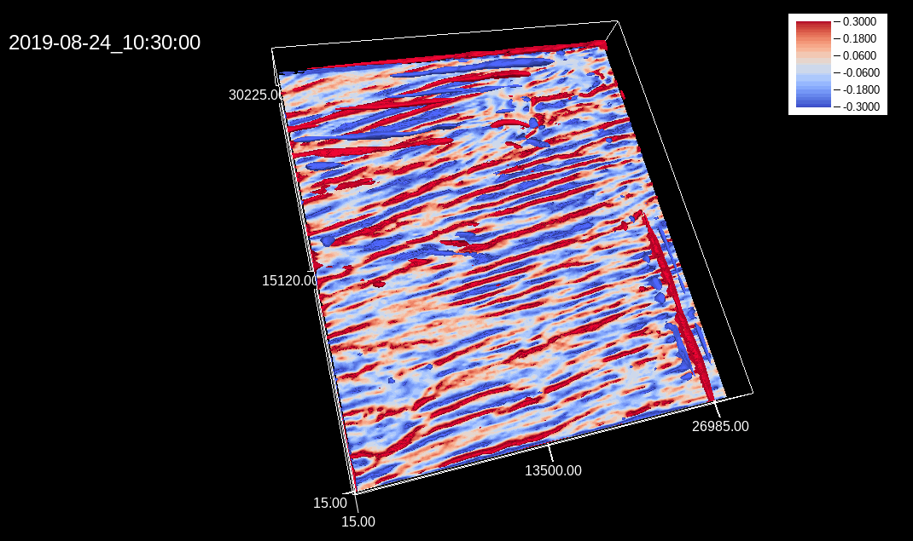
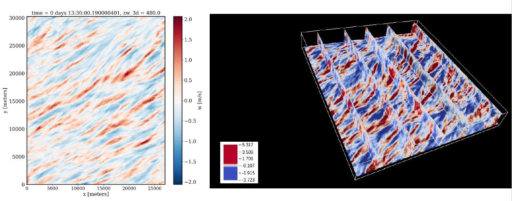
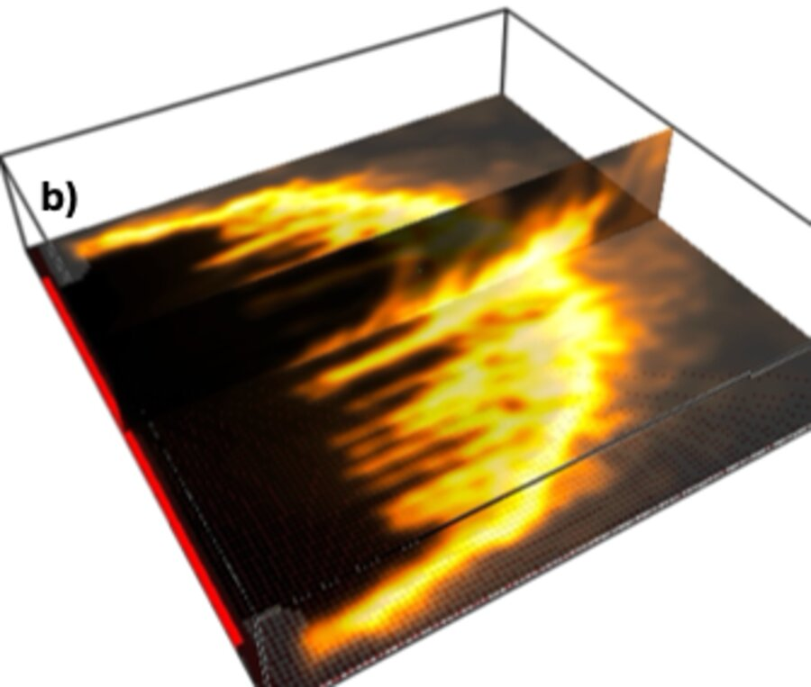
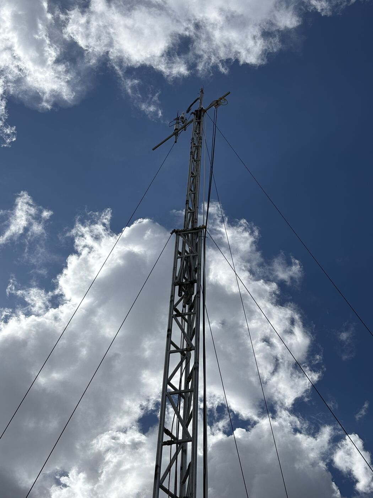

```{=html}
<section class="hero">
  <div class="wrap">
    <div>
      <p class="eyebrow">Department of Atmospheric Sciences · Texas A&amp;M University</p>
      <h1>The lowest kilometer of the <em>atmosphere</em></h1>
      <p class="lede">Accurate and reliable knowledge of  surface-atmospheric exchanges is essential to inform our theories and models of Earth system processes. Terrestrial ecosystems and the atmospheric boundary layer (ABL) act as important intermediaries for these exchange processes. Our primary research interest is in developing process-based frameworks to disentangle the multiple properties that covary at multiple scales. We achieve this by combining observational data from targeted field campaigns with numerical models and bottom up scaling from local measurements into gridded data.</p>
      <div class="actions">
        <a class="btn-hero primary" href="research.html">Explore our research →</a>
        <a class="btn-hero ghost" href="join.html">Prospective students</a>
      </div>
    </div>
    <figure>
      <picture>
        <source media="(prefers-reduced-motion: reduce)" srcset="assets/img/les-w-still.jpg">
        
      </picture>
      <figcaption class="mono">
        <span>PALM LES · CHEESEHEAD19 domain · 24 Aug 2019</span>
        <span class="cbar"><span>w&lt;0</span><i></i><span>w&gt;0</span></span>
      </figcaption>
    </figure>
  </div>
</section>

<section class="block">
  <div class="wrap">
    <div class="head"><p class="eyebrow">What we study</p><a href="research.html">All research →</a></div>
    <div class="themes">
      <a class="theme" href="research.html#heterogeneity">
        
        <div class="body">
          <h3>Surface heterogeneity &amp; land–atmosphere interactions</h3>
          <p>How patchy forests, wetlands and lakes modulate near-surface fluxes, and how to represent those effects in Earth system models.</p>
          <div class="tags"><span class="tag">LES</span><span class="tag">CHEESEHEAD19</span><span class="tag">Bankhead</span></div>
        </div>
      </a>
      <a class="theme" href="research.html#fire">
        
        <div class="body">
          <h3>Fire weather &amp; fire dynamics</h3>
          <p>Canopy turbulence and micrometeorology applied to wildland fire: how vegetation and near-surface stability shape the way a fire front spreads.</p>
          <div class="tags"><span class="tag">Canopy turbulence</span><span class="tag">Fire LES</span><span class="tag">Stability</span></div>
        </div>
      </a>
      <a class="theme" href="research.html#transport">
        
        <div class="body">
          <h3>Regional transport &amp; surface energy balance</h3>
          <p>Scaling from single-point tower measurements to the landscape with aircraft, tower networks and models, and closing the surface energy budget.</p>
          <div class="tags"><span class="tag">Airborne EC</span><span class="tag">TexAQS</span><span class="tag">W m⁻²</span></div>
        </div>
      </a>
    </div>
  </div>
</section>

<section class="block">
  <div class="wrap split">
    <div>
      <div class="head"><div><p class="eyebrow">Lab news</p><h2>Latest</h2></div><a href="news.html">All news →</a></div>
```

::: {#home-news}
:::

```{=html}
    </div>
    <div>
      <div class="head"><div><p class="eyebrow">Publications</p><h2>Recent papers</h2></div><a href="publications.html">All papers →</a></div>
```

::: {#home-pubs}
:::

```{=html}
    </div>
  </div>
</section>

<section class="block">
  <div class="wrap">
    <div class="head"><div><p class="eyebrow">From the field and the model</p><h2>Photos</h2></div><a href="photos.html">Gallery →</a></div>
```

::: {#home-photos}
:::

```{=html}
  </div>
</section>

<section class="block">
  <div class="wrap">
    <div class="join">
      <div>
        <h2>We're building the lab. Join us.</h2>
        <p>We're looking for graduate students and postdocs who want to work across field measurements, data analysis and large-eddy simulation.</p>
      </div>
      <a class="btn-join" href="join.html">How to join →</a>
    </div>
  </div>
</section>
```
