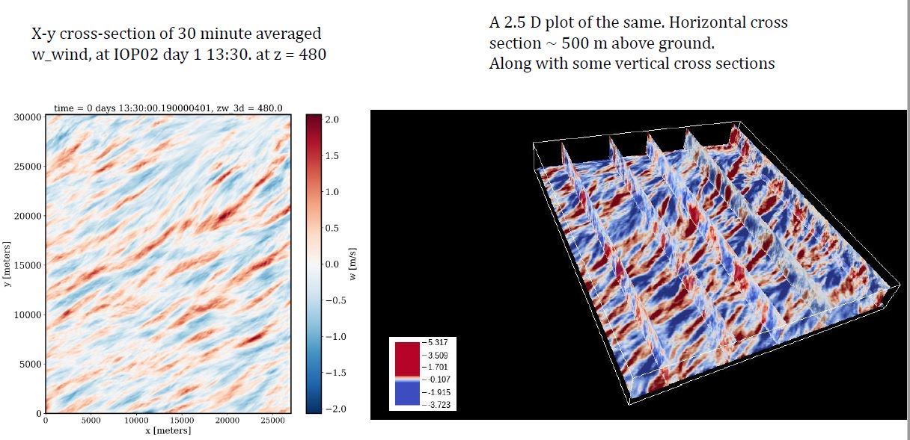
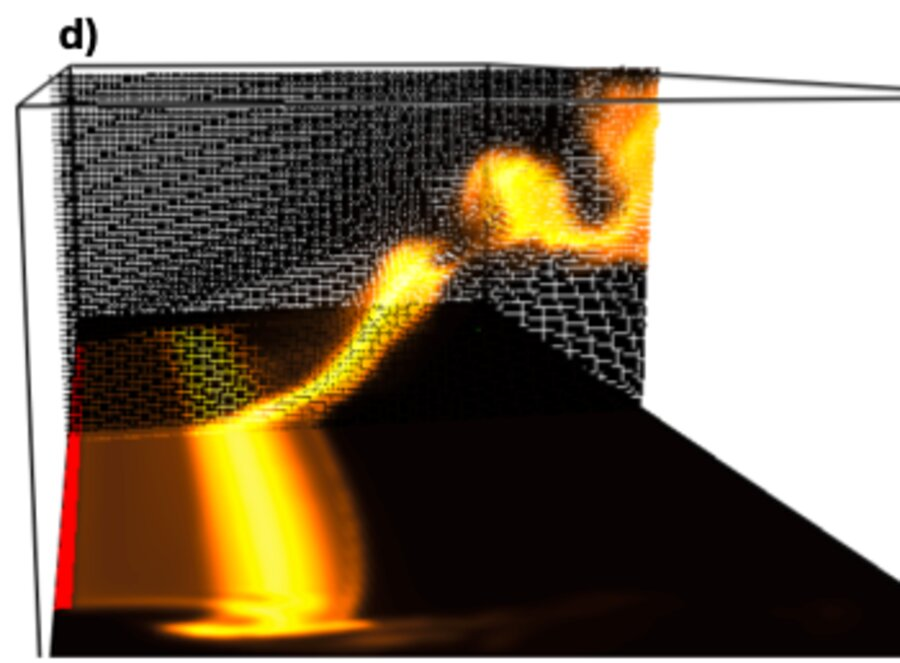
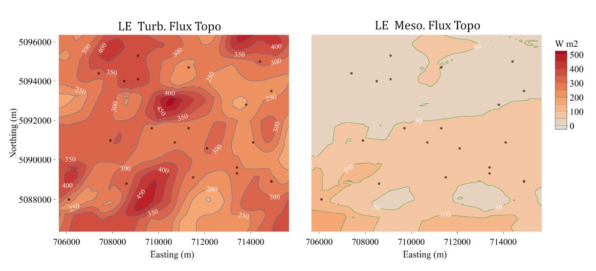

::::: {.wrap .page-title}
[Research]{.eyebrow}

# Multi-scale surface–atmosphere exchange

The boundary layer is where the land surface and the free atmosphere meet. Turbulence here sets how fast heat, moisture and carbon are exchanged, and its structure depends on what lies underneath. We combine field campaigns, airborne measurements and large-eddy simulation to measure and model that exchange.
:::::

::::::::: {.wrap .page-body}

<!-- ======================= THEME 1 ======================= -->
:::::: {#heterogeneity .theme-row}
::: media
{fig-alt="Thirty-minute averaged vertical velocity from a PALM simulation"}

[PALM LES over the CHEESEHEAD19 domain: 30-min mean vertical velocity reveals heterogeneity-driven secondary circulations.]{.cap}
:::

::::: text
[Theme 1]{.eyebrow}

## Surface heterogeneity and land–atmosphere interactions

Real landscapes are patchworks of forest, wetland, lakes and fields. That patchiness organizes the turbulence above it into persistent secondary circulations, which change the near-surface fluxes of heat, water and carbon in ways a single tower can miss. We combine dense field networks with large-eddy simulation to measure these effects, and work on representing them in the land surface schemes of Earth system models.

::: projects
- **DOE AMF3 at Bankhead, Alabama · ongoing** Canopy-cloud coupling over a southeastern US forest
- **CHEESEHEAD19, northern Wisconsin** PALM large-eddy simulations of a 27 × 30 km forest–wetland–lake domain with LiDAR canopy and HRRR forcing
- **Virtual flights for experiment design** LES-based observing system simulation experiments (Metzger et al., 2021)
:::
:::::
::::::

<!-- ======================= THEME 2 ======================= -->
:::::: {#fire .theme-row}
::: media
:::: pair
{fig-alt="Wind-driven grassland fire front with along-wind streaks of high temperature"}

{fig-alt="Crown fire plume rising through a tall canopy and bending with the flow"}
::::

[Temperature fields from LES of fires. Left: wind-driven grassland fire, U = 15 m s⁻¹, N~c~ = 0.26, t = 32 s. Right: crown fire in a tall canopy, U = 7 m s⁻¹, N~c~ = 0.2, t = 18 s.]{.cap}
:::

::::: text
[Theme 2]{.eyebrow}

## Fire weather and fire dynamics

Wildland fires burn inside the atmospheric surface layer. Canopy turbulence and boundary layer stability also control how a fire front behaves. Using large-eddy simulations of grassland and forest fires, we study the role of near-surface static stability and vegetation in fire spread. Wind-driven grass fires develop along-wind aligned structures, taller canopies produce strong fire–turbulence interactions, and together vegetation and boundary-layer dynamics are a significant predictor of fire-front behavior.

::: projects
- **Fire spread, stability and vegetation** NIST Fire Dynamics Simulator in LES mode: 50 × 50 m grassland domains at 0.5 m resolution and 100 × 50 × 30 m forest domains
- **Fire weather in complex terrain** Land–atmosphere interactions in mountain watersheds with a fire-weather focus
:::
:::::
::::::

<!-- ======================= THEME 3 ======================= -->
:::::: {#transport .theme-row}
::: media
{fig-alt="Maps of turbulent and mesoscale latent heat flux in watts per square meter"}

[Latent heat flux topography from airborne eddy covariance: turbulent (left) and mesoscale (right) contributions, W m⁻².]{.cap}
:::

::::: text
[Theme 3]{.eyebrow}

## Regional surface–atmosphere transport and surface energy balance

Most of what we know about surface fluxes comes from single towers, but weather and climate models need fluxes over entire grid cells. We scale up from point measurements to the landscape using aircraft eddy covariance, tower networks and wavelet methods that resolve fluxes in both space and scale. We also study why the measured surface energy budget so often fails to close.

::: projects
- **TexAQS field campaign, Texas · 2026** Tower and mobile-lab measurements of surface–atmosphere exchange
- **Airborne flux mapping, CHEESEHEAD19** Space-scale resolved fluxes from the University of Wyoming King Air (Paleri et al., 2022)
- **SPLASH, East River, Colorado** Surface energy budget across a mountain valley through snow-cover transitions; bulk Richardson flux parameterization for NWP
- **INCOMPASS, Indian subcontinent** Eddy-covariance network across four climate zones during the 2016 monsoon (Bhat et al., 2019)
:::
:::::
::::::

:::::::::
